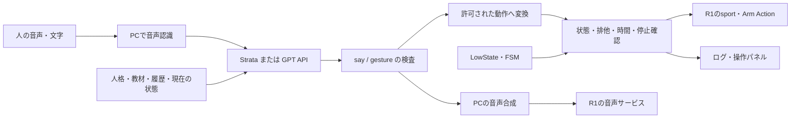

# WWG-R1 ナレッジ集

2026-11-15時点のコード、開発記録、実機での確認をまとめる。後日の変更では、まず [起動設定](../local_tools/r1_startup.json) と実際の稼働状態を確認する。開発の経緯と担当は [開発日誌](DEVELOPMENT_DIARY.md)、個別の根拠は [技術Q&A](TECHNICAL_QA_REFERENCE.md) を参照する。

## 1. 目的と設計

R1は、工場の新人に機械の操作方法と理由を教え、操作ミスによる事故を減らす研修担当として振る舞う。人格の意味は固定し、言い回しと身ぶりはLLMが会話ごとに選ぶ。

> AIは何をするか決める。プログラムはどう実現するか決める。安全機構は実行してよいか決める。

この設計でいう安全機構は、許可された動作、機体モード、指令の重複、データの鮮度などを確認するもの。周囲の安全や工場設備の状態を自動で認識する機能ではない。



音声と制御はPC側のプログラムからLAN経由で送る。R1のOnboard PCへログインして独自プログラムを追加する運用は行っていない。

## 2. 現在の保存設定

| 項目 | 設定 | 注意点 |
|---|---|---|
| パネル | 127.0.0.1:8770 | このPC内だけで開く |
| 接続 | Ethernet、DDS送信元192.168.123.164 | R1の接続先は192.168.123.161 |
| 推論先 | GPT API / gpt-5-mini | Strataへ手動切替可能。自動フォールバックではない |
| 人格 | 熟練工の研修担当R1 | LoRAの追加学習ではなく、自己像と指示文による設定 |
| マイク | Nothing Ear (3a) | 同じ機器名のWASAPIを優先。番号固定にしない |
| 認識 | faster-whisper small / CUDA / float16 | 日英auto。実話者のなまりの精度は別途評価 |
| 読み上げ | 日本語Ichiro、英語David | Windowsに入っている声を使う |
| 音声出力 | 本体100、送信前+12.0412 dB | 小さいPCMの増幅係数は約4。聴感上の倍率ではない |
| 手動押下中の指令 | 並進0.9 m/s、旋回1.8 rad/s | アプリの指定値。実測速度・メーカー保証上限ではない |
| 会話からの前進 | 0.3 m/s・2秒 | 利用者の明示的な依頼など、実行条件を満たす場合だけ |
| 発話検出 | 閾値0.026、無音0.8秒 | 画面で変えた値は、再起動時に保存設定へ戻る |
| 教材 | logs/training/live_materials.json | この保存ファイルはGit対象外 |

Z840の接続先・ユーザー名・鍵の場所、CUDA DLLのPC固有パスはGit対象外の `local_tools/r1_local_settings.ps1` で渡す。別PCではそのPC用に準備する。鍵の内容、会話ログ、音声、録画、個人の作業パスを公開資料へ転載しない。

## 3. 起動・再起動・終了

リポジトリのルートで実行する。別フォルダーから呼ぶ場合は、`-File` にスクリプトの絶対パスを指定する。

```powershell
# LAN実機：接続確認 → パネル → ブラウザ
pwsh -NoProfile -ExecutionPolicy Bypass -File .\local_tools\start_r1.ps1

# 安全終了の確認を通してから起動し直す
pwsh -NoProfile -ExecutionPolicy Bypass -File .\local_tools\start_r1.ps1 -Restart

# 安全終了
pwsh -NoProfile -ExecutionPolicy Bypass -File .\local_tools\start_r1.ps1 -Stop

# R1未接続：PCでマイク・チャットを試す
pwsh -NoProfile -ExecutionPolicy Bypass -File .\local_tools\start_r1.ps1 -Offline

# LAN未接続でも実行内容を確認する
pwsh -NoProfile -ExecutionPolicy Bypass -File .\local_tools\start_r1.ps1 -DryRun
```

通常起動は、同じ設定の実機パネルが動作中なら既存パネルを開く。起動は歩行・起立・通話を開始しない。実機の歩行は起動時にロックし、新しい状態データで「停止を再確認」が通ってから許可する。

明示的な `-Stop` / `-Restart` は `/api/shutdown` へ終了準備を依頼する。新しい会話・録音・動作の受付を止め、進行中の返事が後から再生・実行されないようにし、録音中の音声は認識に送らず破棄する。実機ではゼロ速度送信後の新しい関節データによる静止確認が必要。起立・姿勢変更・腕の動作中は終了を拒否し、終了準備で停止を再確認できない場合も終了を保留する。

HTTP成功だけでは終了完了としない。終了要求前にOSのプロセスハンドルを保持し、親パネルと音声認識等の子プロセスの終了、親の終了コード0を確認する。終了待ちの失敗を強制終了で隠さず、再起動を中断する。安全終了APIを持たない旧版や、プロセスの対応関係が不明なパネルも自動で強制終了しない。

終了対象はPC上のパネルと子プロセスであり、R1の電源断や脱力指令ではない。LAN切断中は実機の停止確認ができないため、安全終了が確認できた扱いにしない。確認失敗時はパネルと監視を残し、状態復旧後に再試行する。

## 4. LANとDDSで分かったこと

ping成功は、DDSの状態受信やRPCの成功を保証しない。このPCのEthernetには複数のIPv4があり、アダプター名だけの指定では別用途のIPを送信元に選んでいた。

- `dds_network.configure_dds_address` はSDKファイルを書き換えず、このプロセスのDDS設定へ送信元IPv4を指定する。
- この環境では `name` と `address` の同時指定が別名不一致になり、`address` だけの指定で復旧した。
- LANがPublicへ戻る場合があった。補助スクリプトは指定した物理Ethernetだけを対象にする。
- 既存の別IP、DNS、経路を削除しない。DHCP有効時にIP追加が必要な場合など、維持を確認できない条件は自動変更を中止する。
- Z840のStrataはSSHコマンド経由で利用する。トンネルを許可する設定変更や、Erika側のモデル差替えは行っていない。

根拠: [DDS設定](../r1_chat/dds_network.py)、[LAN補助](../local_tools/prepare_r1_lan.ps1)、[SSH中継](../r1_chat/ssh_relay.py)。

## 5. 会話・人格・教材

本番はLLMの即興対話であり、31段の固定台本は動作順序や待ち合わせを再現する回帰試験用として残す。

| 話題 | 生成してよい内容 | 守る条件 |
|---|---|---|
| 架空作業 | 例、理由、小話、ユーモア | 教材と会話の合意事項を保つ |
| 実際の内部実装 | コードに基づく説明 | 未確認の機能・値・動作結果を作らない |
| 存在意義 | 自然な自己紹介や説明 | 新人教育、操作ミスによる事故防止、AIとプログラムの役割を保つ |

AIの出力は `say` と `gesture` のJSON。形式、長さ、許可された動作を検査し、不正な場合は身ぶりなしの文章を1回だけ取り直す。現在の推論先・モデル・実機/ローカル接続は毎回の文脈へ反映し、通常構成を現在の稼働状態と取り違えない。

研修の段階は「説明→見本→一つ質問→実際の新人の返答待ち」。プログラムは段階を管理し、LLMが言葉と身ぶりを選ぶ。新人が答えたことや理解したことを想像して先へ進めない。

人格・教材の変更はLoRA学習ではない。帽子の演出は予約名と絵コンテがある段階で、専用動作の実機登録・再生は未確認。ver3に合わせた口調・押し間違い設定・長い説明等の調整は依頼済み・未着手で、担当は未確定。依頼・提案と実装済みの内容を区別して管理する。

根拠: [自己像](../r1_chat/identity.py)、[人格と出力検査](../r1_chat/personas.py)、[研修進行](../r1_chat/training_flow.py)、[技術の事実集](../r1_chat/tech_facts.py)。

## 6. 音声入力と出力

通話は半二重。相手を聞き、認識・応答・再生を行い、返事が終わってから再び聞く。発話への割り込みや話者識別は実装していない。

Nothing Earでは、Windowsに機器が表示されていても開始時にPortAudio -9999が出た。固定番号を避け、同じ機器名のWASAPIを優先する。開始失敗や入力停止、3秒のデータ途絶では同じ機器の接続を待ち、切断前の未処理音声・返事を復帰後に再利用しない。別のマイクへ黙って切り替えない。

実機モードでは、失敗した入力を閉じた後にプロセス内のPortAudio機器情報を更新する。ローカル音声出力もPortAudioを使うため、ローカル試験ではこの再初期化を無条件に有効化していない。これは装着センサーではなく、Windowsの入力状態を見ている処理である。

日英autoは候補言語を日本語と英語に絞り、日本語を優先する。英語の声は最初の英語応答で用意する。合成音声での確認を、インドなまりの実話者・会場マイクでの認識精度の証明にはしない。

本体音量100と送信前PCMの増幅は別の設定。+12.0412 dBは小さい波形の増幅係数約4に相当し、大きい波形はソフトリミッターで丸める。聴感上の音量が正確に4倍になる意味ではない。

根拠: [機器選択](../r1_chat/audio_input.py)、[通話と再接続](../r1_chat/voice_call.py)、[認識worker](../r1_chat/stt_worker.py)、[音声合成・送信](../r1_chat/r1_chat.py)。

## 7. 歩行・旋回・停止

この個体では速度指令7105とゼロ速度の両方で127が返る。127を互換扱いにしても、実際に動いた・止まったことの証拠にはしない。

- 手動ボタンは押下中だけ継続更新する。ブラウザ更新0.2秒、リース0.75秒、指令更新0.3秒、ネイティブduration2秒。
- 離す、画面離脱、更新期限切れ等でゼロ速度を要求する。解除済みトークンと起動・停止の世代番号で古い開始要求を拒否する。
- 歩行と腕・起立・会話処理の重複を制限する。LLMの候補だけで自由な関節角へ変換しない。
- 0.3 m/s・2秒の前進と停止は利用者が目視確認した。後日の「動いた」という報告もあるが、未記録の方向・距離・速度を追加認定しない。
- 関節変化は床上の移動距離の証明ではない。指定値を機体のメーカー上限や移動性能として説明しない。

根拠: [歩行制御](../r1_motion/body_control.py)、[押下操作UI](../r1_chat/web_ui.html)、[監視](../r1_motion/body_feedback.py)。

## 8. LowState無更新からの復旧

通信障害後、FSMや腕のRPCは復旧した一方、脚の状態データが約12:32の値から更新されず、`stop_not_observed:stale` で歩行がロックされた。元の通信断がLAN切断か機体再起動か、初回の内部例外の詳細まではログで断定できない。

対策は次のとおり。

1. 新しい有効データが1秒以上採用されなければ、LowState readerだけを同じ受信スレッドで作り直す。
2. 再接続後、CRC正常で進行するtickを3件以上・0.2秒以上確認するまで無効状態を維持する。
3. 受信世代が変われば静止観測の窓や確認履歴を混ぜない。
4. 停止未確認ロックは、明示的なゼロ速度後の新しい同一世代データで0.5秒の静止を確認して解除する。
5. `body.monitor` で受信時刻、採用時刻、tick、再接続回数、読取スレッドの状態を確認できるようにする。

実機データを読むだけの別プロセスで、受信側の連番判定を意図的に進まなくし、reader再作成と受信復旧を確認した。これは実際のLAN切断や機体再起動を起こした試験ではない。完全に停止したネイティブReadを安全に終了できない場合は、重複readerを作らずロックを維持する。

## 9. 起立・腕・未実装の範囲

仰向けからの起立は、姿勢と準備の明示確認を必要とするR1用の高レベル手順を使う。観測された手順は `0→1→4→701→811`。指令エラーを勝手に再送せず、読取だけを最大3回再試行する。途中の読取失敗後、状態を確認して残りの手順へ再開した実機記録があり、利用者が安定立位を確認した。

新しい低レベル関節動作の実機送信は保留。カメラによる人・ボタン・障害物の認識、精密な位置移動、工場設備の直接操作も未実装。仮想R1はユーザー指示で凍結しており、保存データを維持する。`-Offline` はPCだけの会話試験で、仮想器の起動ではない。

## 10. 再現する検証

```powershell
# 実機へ接続しないPython回帰テスト
pixi run python -m unittest discover -s tests

# API・プロセス操作を模擬する起動スクリプトのテスト
pwsh -NoProfile -ExecutionPolicy Bypass -File .\tests\test_r1_launcher.ps1
```

| 検証 | 確認できること | その検証だけでは分からないこと |
|---|---|---|
| 単体・模擬API | 形式、排他、古い要求の取消、停止ゲート、終了順序 | 実機の移動・転倒・実距離 |
| PCローカルの起動・終了 | パネルの置換、親子プロセスの終了、ポートの解放 | LAN実機の停止確認を含む終了サイクル |
| PC実入力 | マイク開始、データ到着、文字起こし | 全Bluetooth状態・全話者での精度 |
| 実機の読み取り専用試験 | LowState受信とreader復旧 | 歩行や実際のLAN断からの全復旧 |
| 実機ゼロ速度＋関節観測 | 指令後の新しい静止観測 | 周囲の安全、床上の位置、非常停止性能 |
| 利用者の目視 | その試行での移動・停止・姿勢 | メーカー保証、再現性の統計、測定していない数値 |

2026-11-15の安全終了追加後、Python449件、起動スクリプト74ケース・350項目が通過した。15:04には `-Offline` で終了→再起動→終了を確認し、パネル・音声認識プロセスと8770の待受が残らないことを確認した。新しい安全終了の実機サイクルは、LAN未接続のため未確認として扱う。

次回の優先事項は、LAN接続状態での安全終了・再起動、ver3会話方針の確定と調整、実話者による日英認識、帽子の専用動作の準備である。
